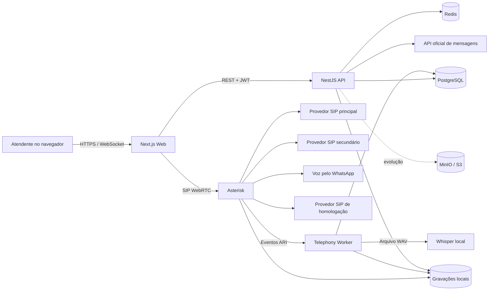

# Omni Platform

Plataforma interna de atendimento omnichannel com WhatsApp, telefonia SIP,
gravações e transcrição de chamadas.

## 1. Visão geral

O **Omni Platform** é uma aplicação interna para centralizar o atendimento por
WhatsApp e telefonia. O foco atual é permitir que vendedores e atendentes façam
e recebam chamadas por ramais individuais, enquanto supervisores e
administradores acompanham a operação, escutam gravações e consultam
transcrições.

Diretório local esperado para desenvolvimento:

```text
{{diretorio_local}}\omni-platform
```

## 2. Estado atual

### Implementado

- Autenticação com perfis e permissões.
- Caixa de entrada para conversas do WhatsApp.
- Janela de atendimento de 24 horas da API oficial de mensagens.
- Painel de telefonia.
- Discador WebRTC com teclado, DTMF, mudo e espera.
- Agenda de contatos com clique para ligar.
- Campanhas de discagem progressiva com distribuição de um contato por vez.
- Registro de resultado e observações por contato da campanha.
- Ramais WebRTC individuais no navegador.
- Ligações telefônicas por troncos SIP configuráveis.
- Estrutura SIP para chamadas de voz do WhatsApp.
- Recebimento autenticado e idempotente de eventos de voz pelo WhatsApp.
- Monitoramento de conexão e restrições temporárias da conta de voz.
- Histórico de ligações com filtros por dia, colaborador, canal e status.
- Gravação automática das chamadas atendidas.
- Reprodução protegida das gravações pela API.
- Transcrição local com `faster-whisper`.
- Alternativa de transcrição pela OpenAI.
- Retentativas automáticas de transcrição.
- Painel administrativo diário.
- Dashboard consolidado com período, direção, colaborador, canal e status.
- Cards de volume, falhas, conclusões e tempos de conversação.
- Série temporal por hora, dia, semana e mês, separando entrada e saída.
- Tabela detalhada com reprodução, transcrição e exportação CSV.
- Cadastro, ativação e desativação de colaboradores.
- Atribuição automática de ramais.
- Separação de acesso entre administrador, supervisor e atendente.
- Isolamento de organizações no PostgreSQL com Row Level Security.

### Validações locais registradas

Referência histórica: entrega de 21/08/2026, cujo código foi registrado no
commit `2b6b3ed`. Os itens abaixo resumem as verificações daquela entrega, não
uma confirmação de que serviços ou troncos estejam ativos hoje. Esta revisão
documental de 03/09/2026 não repetiu os testes funcionais nem as chamadas reais.

- Autenticação e separação de acesso entre administrador e atendente.
- Atendente limitado ao próprio ramal, chamadas, gravações e transcrições.
- Bloqueio HTTP `403` para atendente no dashboard e na gestão de colaboradores.
- Dashboard administrativo em desktop e viewport móvel de 390 px.
- Migrações, Row Level Security, lint, typecheck, testes e build completo.
- Registro dos troncos existentes no Asterisk local.
- Discagem WebRTC, eventos ARI, persistência, gravação e transcrição local.
- Dialplan com início, atendimento e encerramento reais da chamada.
- Webhook de voz com token, deduplicação e roteamento por organização.

### Pendente ou parcialmente validado

- Fazer novos testes reais de entrada e saída para cada tronco contratado.
- Configurar uma URL HTTPS temporária para receber eventos externos no ambiente
  local; nenhum túnel está ativo por padrão.
- Correlacionar deterministicamente o ID externo da chamada com o ID do Asterisk
  antes de importar gravações mantidas pelo provedor.
- Registrar o encerramento do pós-atendimento; enquanto o campo não existir, a
  interface exibe `Não disponível`.
- Migrar gravações para armazenamento em objeto e definir retenção e descarte.
- Implementar auditoria de reprodução/download, backup externo, monitoramento e
  testes de chamadas simultâneas.

Não existe ambiente online ativo. A versão mais avançada e a fonte de verdade
estão no repositório e no ambiente local. Nenhum deploy em nuvem faz parte do
fluxo atual.

As pendências operacionais atuais, os limites dos testes locais e os requisitos
para uma eventual publicação futura estão em
[`docs/URGENTES-OPERACAO.md`](docs/URGENTES-OPERACAO.md).

A arquitetura, a operação local e o checklist específico do discador estão em
[`docs/DISCADOR.md`](docs/DISCADOR.md).

O escopo consolidado do dashboard, do discador, das integrações SIP, das
validações e das pendências desta entrega está em
[`docs/ENTREGA-TELEFONIA-2026-08-13.md`](docs/ENTREGA-TELEFONIA-2026-08-13.md).

A configuração e os limites da voz pelo WhatsApp estão em
[`docs/VOZ-WHATSAPP-LOCAL.md`](docs/VOZ-WHATSAPP-LOCAL.md).

O plano de evolução que mantém as regras de negócio no Omni e limita a
plataforma telefônica externa a um adaptador substituível está no prompt mestre
[`docs/PROMPT-EVOLUCAO-INDEPENDENTE-TELEFONIA.md`](docs/PROMPT-EVOLUCAO-INDEPENDENTE-TELEFONIA.md).

## 3. Arquitetura



### Componentes

| Componente | Tecnologia | Responsabilidade |
|---|---|---|
| `apps/web` | Next.js 15, React 19, SIP.js | Interface, sessão e telefone WebRTC |
| `apps/api` | NestJS 11 | Autenticação, conversas, telefonia e controle de acesso |
| `apps/telephony-worker` | Node.js, WebSocket ARI | Eventos de chamadas, gravações e transcrições |
| `apps/workers` | TypeScript, Node.js | Base para workers de processamento assíncrono em segundo plano |
| `packages/db` | Drizzle ORM, PostgreSQL | Schema, migrações e isolamento multiempresa |
| `packages/auth` | JWT, Argon2 | Senhas, tokens, perfis e permissões |
| `packages/config` | Zod | Validação das variáveis de ambiente |
| `packages/observability` | Logs estruturados | Logs com ocultação de dados sensíveis |
| `packages/provider-contracts` | TypeScript | Contratos para SIP, WhatsApp, storage e transcrição |
| `packages/queue-kit` | BullMQ, ioredis | Estrutura de enfileiramento e gerenciamento de filas Redis |
| `packages/testing` | TypeScript | Provedores simulados (mocks) e utilitários para suíte de testes |
| `infra/asterisk` | Asterisk 20 | PBX, ramais, filas, troncos e gravação |
| `infra/whisper` | Python, faster-whisper | Transcrição local de áudio |
| `infra/docker-compose.yml` | Docker Compose | PostgreSQL, Redis, MinIO, Asterisk e Whisper |

## 4. Estrutura do repositório

```text
omni-platform/
├── apps/
│   ├── api/
│   ├── telephony-worker/
│   ├── web/
│   └── workers/
├── infra/
│   ├── asterisk/
│   ├── whisper/
│   └── docker-compose.yml
├── packages/
│   ├── auth/
│   ├── config/
│   ├── db/
│   ├── eslint-config/
│   ├── observability/
│   ├── provider-contracts/
│   ├── queue-kit/
│   ├── testing/
│   └── tsconfig/
├── .env.example
├── package.json
├── pnpm-workspace.yaml
└── turbo.json
```

## 5. Requisitos para desenvolvimento

- Windows 10 ou 11.
- Docker Desktop.
- Node.js 20 ou superior.
- pnpm 11.18 ou compatível.
- Git.
- Microfone e permissão de áudio no navegador.
- Credenciais de um provedor SIP para testes reais.

## 6. Instalação local

### 6.1 Instalar dependências

```powershell
cd {{diretorio_local}}\omni-platform
pnpm install
```

### 6.2 Criar o arquivo de ambiente

```powershell
Copy-Item .env.example .env
```

Preencha o `.env` local. Nunca publique esse arquivo e nunca copie senhas para
documentação, issues ou commits.

As principais categorias são:

- API, Web e URLs locais.
- PostgreSQL e role restrita da aplicação.
- Redis.
- MinIO/S3.
- segredos JWT.
- Asterisk ARI e WebRTC.
- provedores SIP de telefonia.
- provedor de voz pelo WhatsApp.
- API oficial de mensagens do WhatsApp.
- Whisper local ou OpenAI.

#### Detalhamento das variáveis de ambiente

| Variável | Descrição |
|---|---|
| `NODE_ENV` | Ambiente de execução (`development`, `test`, `production`). |
| `LOG_LEVEL` | Nível mínimo de log (`debug`, `info`, `warn`, `error`). |
| `API_PORT` | Porta HTTP da API NestJS (padrão: `3001`). |
| `WEB_PORT` | Porta HTTP do frontend Web Next.js (padrão: `3000`). |
| `API_BASE_URL` | URL base da API para clientes HTTP (padrão: `http://localhost:3001`). |
| `WEB_BASE_URL` | URL base da aplicação Web, usada para redirecionamentos e CORS (padrão: `http://localhost:3000`). |
| `POSTGRES_USER` | Usuário administrativo do PostgreSQL no Docker (padrão: `omni`). |
| `POSTGRES_PASSWORD` | Senha do usuário administrativo do PostgreSQL. |
| `POSTGRES_DB` | Nome do banco de dados no PostgreSQL (padrão: `omni`). |
| `POSTGRES_PORT` | Porta exposta do PostgreSQL no host (padrão: `5432`). |
| `DATABASE_ADMIN_URL` | URL de conexão administrativa com o PostgreSQL (para migrações e bootstrap de roles; ignora RLS). |
| `APP_DB_USER` | Nome do usuário restrito da aplicação sujeito às políticas de RLS (padrão: `omni_app`). |
| `APP_DB_PASSWORD` | Senha do usuário restrito da aplicação. |
| `DATABASE_URL` | URL de conexão do PostgreSQL usada pela API com a role restrita da aplicação. |
| `REDIS_PORT` | Porta exposta do Redis no host (padrão: `6379`). |
| `REDIS_URL` | URL de conexão com a instância do Redis (padrão: `redis://localhost:6379`). |
| `MINIO_ROOT_USER` | Usuário administrador raiz do MinIO. |
| `MINIO_ROOT_PASSWORD` | Senha administrativa do MinIO. |
| `MINIO_PORT` | Porta da API S3 compatível do MinIO (padrão: `9000`). |
| `MINIO_CONSOLE_PORT` | Porta do console web do MinIO (padrão: `9001`). |
| `STORAGE_DRIVER` | Driver de armazenamento de objetos (ex.: `s3`). |
| `STORAGE_ENDPOINT` | Endpoint HTTP da API compatível com S3 (padrão: `http://localhost:9000`). |
| `STORAGE_REGION` | Região do bucket S3 (padrão: `us-east-1`). |
| `STORAGE_BUCKET` | Nome do bucket para arquivos de gravação (padrão: `omni-recordings`). |
| `STORAGE_ACCESS_KEY_ID` | Chave de acesso (Access Key) do storage S3/MinIO. |
| `STORAGE_SECRET_ACCESS_KEY` | Chave secreta (Secret Key) do storage S3/MinIO. |
| `STORAGE_FORCE_PATH_STYLE` | Habilita uso de path-style URLs no S3 (obrigatório para MinIO; padrão: `true`). |
| `STORAGE_SIGNED_URL_TTL_SECONDS` | Tempo de validade em segundos para URLs pré-assinadas de reprodução de gravações (padrão: `300`). |
| `JWT_ACCESS_SECRET` | Segredo criptográfico de assinatura do access token JWT (mínimo de 32 caracteres). |
| `JWT_REFRESH_SECRET` | Segredo criptográfico de assinatura do refresh token JWT (mínimo de 32 caracteres, distinto do access secret). |
| `JWT_ACCESS_TTL` | Duração de validade do access token (padrão: `15m`). |
| `JWT_REFRESH_TTL` | Duração de validade do refresh token em cookie httpOnly (padrão: `7d`). |
| `SIP_PROVIDER_DRIVER` | Driver de telefonia SIP (`mock` para testes sem infraestrutura telefônica ou `real`). |
| `WHATSAPP_PROVIDER_DRIVER` | Driver de WhatsApp (`mock` ou `real`). |
| `TRANSCRIPTION_PROVIDER_DRIVER` | Driver de transcrição de áudio (`mock` ou `real`). |
| `ASTERISK_ARI_URL` | URL da API REST do Asterisk ARI (padrão: `http://localhost:8088`). |
| `ASTERISK_ARI_USERNAME` | Usuário configurado para conexão ARI. |
| `ASTERISK_ARI_PASSWORD` | Senha de autenticação ARI. |
| `ASTERISK_ARI_APP` | Nome da aplicação Stasis no Asterisk (padrão: `omnichannel`). |
| `ASTERISK_ARI_RECONNECT_DELAY_MS` | Tempo em milissegundos de espera antes de reconectar o WebSocket ARI (padrão: `5000`). |
| `ASTERISK_WSS_URL` | URL WebSocket para conexão WebRTC SIP.js do discador (padrão: `ws://localhost:8088/ws`). |
| `ASTERISK_WEBRTC_DOMAIN` | Domínio SIP configurado no Asterisk para ramais WebRTC (padrão: `localhost`). |
| `ASTERISK_EXTERNAL_ADDRESS` | Endereço IP externo ou público do Asterisk para sinalização atrás de NAT. |
| `ASTERISK_STUN_ADDRESS` | Servidor STUN para descoberta de endereços ICE (padrão: `stun.l.google.com:19302`). |
| `ASTERISK_WEBRTC_1001_PASSWORD` | Senha SIP do ramal WebRTC 1001. |
| `ASTERISK_WEBRTC_1002_PASSWORD` | Senha SIP do ramal WebRTC 1002. |
| `ASTERISK_WEBRTC_SECRET` | Segredo mestre opcional para derivação automática de senhas para ramais de 1003 a 1099. |
| `ASTERISK_EXTENSION_START` | Número do primeiro ramal da faixa (padrão: `1001`). |
| `ASTERISK_EXTENSION_END` | Número do último ramal da faixa (padrão: `1099`). |
| `ASTERISK_QUEUE_NAME` | Nome da fila de atendimento no dialplan do Asterisk (padrão: `vendas`). |
| `ASTERISK_QUEUE_STRATEGY` | Estratégia de distribuição de chamadas da fila (padrão: `rrmemory`). |
| `ASTERISK_QUEUE_MEMBER_TIMEOUT` | Tempo limite em segundos para tentativa em cada ramal da fila (padrão: `20`). |
| `ASTERISK_QUEUE_RETRY` | Número de retentativas na fila antes de desistir (padrão: `3`). |
| `ASTERISK_QUEUE_WRAPUP` | Tempo de wrap-up pós-atendimento da fila em segundos (padrão: `5`). |
| `ASTERISK_QUEUE_MAX_WAIT` | Tempo máximo de espera na fila em segundos (padrão: `45`). |
| `ASTERISK_RECORDINGS_PATH` | Diretório no host onde os arquivos de áudio WAV do Asterisk são montados (padrão: `infra/.local/asterisk-recordings`). |
| `ASTERISK_SIP_PORT` | Porta UDP local para sinalização SIP do Asterisk (padrão: `5060`). |
| `ASTERISK_HTTP_PORT` | Porta TCP local para ARI e WebSocket do Asterisk (padrão: `8088`). |
| `ASTERISK_RTP_START` | Porta UDP inicial da faixa RTP de áudio (padrão: `10000`). |
| `ASTERISK_RTP_END` | Porta UDP final da faixa RTP de áudio (padrão: `10099`). |
| `SIP_PROVIDER` | Identificador do provedor SIP principal. |
| `SIP_TRUNK_HOST` | Host do tronco SIP principal. |
| `SIP_AUTH_METHOD` | Método de autenticação do tronco SIP principal. |
| `SIP_USERNAME` | Usuário do tronco SIP principal. |
| `SIP_PASSWORD` | Senha do tronco SIP principal. |
| `SIP_PHONE_NUMBER` | Número DID atribuído ao tronco SIP principal. |
| `SIP_SUPPORTED_CODECS` | Codecs de áudio suportados no tronco principal (ex.: `alaw,ulaw`). |
| `WAVOIP_SIP_HOST` | Host SIP do provedor WaVoIP para voz via WhatsApp (padrão: `sipv2.wavoip.com`). |
| `WAVOIP_SIP_PORT` | Porta do servidor SIP WaVoIP (padrão: `5060`). |
| `WAVOIP_SIP_USERNAME` | Usuário SIP gerado no painel WaVoIP. |
| `WAVOIP_SIP_PASSWORD` | Senha SIP do WaVoIP. |
| `WAVOIP_CALLER_ID` | Identificador de chamada (Caller ID) atribuído na conta WaVoIP. |
| `WAVOIP_SUPPORTED_CODECS` | Codecs de áudio permitidos no tronco WaVoIP (padrão: `alaw,ulaw`). |
| `WHATSAPP_VOICE_WEBHOOK_TOKEN` | Token secreto para autenticação dos webhooks de eventos de voz (mínimo de 32 caracteres). |
| `WHATSAPP_VOICE_ORGANIZATION_ID` | UUID da organização para associar eventos de voz sem número no ambiente local. |
| `TWILIO_SIP_DOMAIN` | Domínio do Elastic SIP Trunking da Twilio. |
| `TWILIO_CALLER_ID` | Caller ID verificado na Twilio para chamadas de saída. |
| `TWILIO_SUPPORTED_CODECS` | Codecs de áudio suportados no tronco Twilio (padrão: `ulaw,alaw`). |
| `NVOIP_SIP_HOST` | Host do servidor SIP da Nvoip (padrão: `app.nvoip.com.br`). |
| `NVOIP_SIP_PORT` | Porta do servidor SIP Nvoip (padrão: `5060`). |
| `NVOIP_SIP_USERNAME` | Usuário de autenticação SIP na Nvoip. |
| `NVOIP_SIP_PASSWORD` | Senha de autenticação SIP na Nvoip. |
| `NVOIP_CALLER_ID` | Caller ID configurado para a rota Nvoip. |
| `NVOIP_SUPPORTED_CODECS` | Codecs de áudio suportados na Nvoip (padrão: `alaw,ulaw`). |
| `META_BUSINESS_ID` | ID do gerenciador de negócios Meta Business. |
| `META_WABA_ID` | ID da conta WhatsApp Business (WABA). |
| `META_PHONE_NUMBER_ID` | ID do número de telefone na Meta Cloud API. |
| `META_APP_ID` | ID do aplicativo cadastrado no Meta for Developers. |
| `META_APP_SECRET` | Chave secreta do aplicativo Meta para validação de assinatura HMAC SHA-256 do webhook. |
| `META_ACCESS_TOKEN` | Token de acesso de sistema para envio de mensagens via Meta Cloud API. |
| `META_GRAPH_API_VERSION` | Versão da Meta Graph API utilizada (padrão: `v21.0`). |
| `META_WEBHOOK_VERIFY_TOKEN` | Token arbitrário de verificação informado no painel da Meta para validação inicial do webhook. |
| `TRANSCRIPTION_PROVIDER` | Provedor de transcrição pós-chamada (`whisper_local` ou `openai`). |
| `TRANSCRIPTION_API_KEY` | Chave de API da OpenAI (obrigatória quando `TRANSCRIPTION_PROVIDER=openai`). |
| `TRANSCRIPTION_MODEL` | Modelo de transcrição (ex.: `small` para local ou `gpt-4o-transcribe-diarize` para OpenAI). |
| `TRANSCRIPTION_LANGUAGE` | Código de duas letras do idioma de transcrição (padrão: `pt`). |
| `TRANSCRIPTION_LOCAL_URL` | URL HTTP do serviço local de transcrição (padrão: `http://127.0.0.1:8090/v1/transcriptions`). |
| `TRANSCRIPTION_REQUEST_TIMEOUT_MS` | Timeout em milissegundos para a chamada de transcrição (padrão: `900000`). |
| `TRANSCRIPTION_BACKLOG_INTERVAL_MS` | Intervalo em milissegundos para reprocessamento de transcrições pendentes ou com falha (padrão: `60000`). |
| `WHISPER_PORT` | Porta exposta do contêiner faster-whisper no host (padrão: `8090`). |
| `WHISPER_MODEL` | Modelo faster-whisper carregado no contêiner (padrão: `small`). |
| `WHISPER_DEVICE` | Dispositivo de computação do faster-whisper (`cpu` ou `cuda`). |
| `WHISPER_COMPUTE_TYPE` | Tipo de quantização/precisão do modelo (padrão: `int8`). |
| `WHISPER_CPU_THREADS` | Número de threads de CPU alocadas ao Whisper (padrão: `8`). |
| `WHISPER_BEAM_SIZE` | Tamanho do beam search para decodificação (padrão: `5`). |
| `WHISPER_MAX_UPLOAD_MB` | Tamanho máximo em MB para envio de arquivos de áudio (padrão: `250`). |
| `OBJECT_STORAGE_PROVIDER` | Identificador do provedor de armazenamento em objeto. |
| `DEPLOYMENT_PROVIDER` | Identificador do provedor de implantação. |
| `DEFAULT_DATA_RETENTION_DAYS` | Prazo padrão em dias para retenção e política de descarte de dados. |

### 6.3 Subir a infraestrutura

```powershell
docker compose --env-file .env -f infra/docker-compose.yml up -d --build
```

### 6.4 Carregar o `.env` no PowerShell

Os comandos do banco leem variáveis do processo. No terminal de
desenvolvimento, carregue o arquivo sem imprimi-lo:

```powershell
Get-Content .env | ForEach-Object {
  if ($_ -match '^\s*([^#][^=]*)=(.*)$') {
    [Environment]::SetEnvironmentVariable(
      $matches[1].Trim(),
      $matches[2].Trim().Trim('"'),
      'Process'
    )
  }
}
```

### 6.5 Preparar o banco

```powershell
pnpm --filter @omni/db db:setup
```

Esse comando executa migrações, cria a role restrita usada pela aplicação e
sincroniza os perfis e permissões.

### 6.6 Criar a primeira organização e o administrador

```powershell
pnpm --filter @omni/db db:create-org "Minha Empresa" minha-empresa "Administrador" admin@empresa.com "uma-senha-temporaria-segura"
```

A senha precisa ter pelo menos 12 caracteres. Como o valor entra no histórico
do terminal, utilize uma senha temporária e faça a troca conforme a política da
empresa.

### 6.7 Iniciar a aplicação

```powershell
pnpm dev
```

## 7. Endereços locais

| Serviço | Endereço padrão |
|---|---|
| Aplicação Web | `http://localhost:3000` |
| API | `http://localhost:3001` |
| Saúde da API | `http://localhost:3001/health` |
| Prontidão da API | `http://localhost:3001/ready` |
| Asterisk ARI | `http://127.0.0.1:8088/ari` |
| Asterisk WebSocket | `ws://localhost:8088/ws` |
| Whisper | `http://127.0.0.1:8090` |
| MinIO API | `http://localhost:9000` |
| MinIO Console | `http://localhost:9001` |
| PostgreSQL | `localhost:5432` |
| Redis | `localhost:6379` |

## 8. Telas do produto

| Rota | Função |
|---|---|
| `/login` | Autenticação |
| `/dashboard` | Tela inicial legada de sessão, identificação e permissões; não é o dashboard de métricas |
| `/inbox` | Conversas e mensagens do WhatsApp |
| `/telefonia` | Estado dos troncos, ramal, equipe e discador |
| `/telefonia/discador` | Discador WebRTC, contatos e campanhas progressivas |
| `/telefonia/ligacoes` | Histórico filtrado de ligações |
| `/telefonia/gravacoes` | Áudios e transcrições |
| `/telefonia/admin` | Dashboard consolidado de métricas, filtros, gráficos, CSV e gestão de colaboradores; somente administrador |

## 9. Perfis e visibilidade

### Administrador

- Visualiza toda a organização.
- Gerencia colaboradores e ramais.
- Consulta ligações, gravações e transcrições da equipe.
- Acessa o painel administrativo.

### Supervisor

- Visualiza os resultados da equipe.
- Consulta ligações e transcrições.
- Escuta e pode baixar gravações conforme a permissão atribuída.
- Não cadastra usuários pelo painel administrativo atual.

### Atendente

- Faz e recebe chamadas pelo próprio ramal.
- Visualiza somente suas ligações.
- Escuta somente suas gravações.
- Visualiza somente suas transcrições.
- Não visualiza outros atendentes.

### Auditor

- Possui acesso de leitura aos dados autorizados.
- Não altera contatos, conversas, canais ou usuários.

O escopo do atendente é aplicado na API, não apenas escondido na interface.

## 10. Telefonia

### 10.1 Ramais

O intervalo padrão é de `1001` a `1099`, totalizando até 99 ramais cadastrados.
O limite real de chamadas simultâneas depende do contrato do provedor, da CPU,
da rede, dos codecs e do dimensionamento do Asterisk.

O administrador pode informar um ramal de quatro dígitos ou deixar a plataforma
selecionar automaticamente o próximo ramal livre.

### 10.2 Ligações de saída

1. O usuário autentica seu ramal SIP.js no Asterisk por WebSocket.
2. O navegador envia a chamada para o Asterisk.
3. O dialplan seleciona o tronco SIP conforme o canal escolhido.
4. O Asterisk inicia a gravação quando a chamada é atendida.
5. Eventos personalizados são enviados pelo ARI.
6. O worker persiste a chamada e agenda a transcrição.

### 10.3 Ligações recebidas

1. O provedor envia o `INVITE` SIP ao Asterisk.
2. O Asterisk encaminha para a fila configurada, por padrão `vendas`.
3. A estratégia padrão é `rrmemory`.
4. O ramal que atende é associado ao colaborador correspondente.
5. O áudio é gravado e processado após o encerramento.

Para receber chamadas em uma máquina atrás de NAT, normalmente são necessários:

- IPv4 público, túnel compatível ou infraestrutura acessível pelo provedor.
- UDP `5060` para sinalização SIP.
- UDP `10000–10099` para RTP.
- firewall restrito aos IPs do provedor sempre que possível.
- SIP ALG desabilitado quando causar registro instável ou áudio unilateral.

O ambiente atual hospeda o Asterisk somente na máquina local. ICE/STUN, RTP
simétrico e `rtp_keepalive` estão configurados, mas chamadas recebidas a partir
da internet dependem de conectividade externa controlada. Redes corporativas
mais restritivas ainda podem exigir um servidor TURN.

### 10.4 Provedores

**Provedor SIP principal:** telefonia fixa e móvel por tronco autenticado. A
entrada pelo DID ainda precisa de uma nova validação completa no ambiente local.

**Provedor SIP secundário:** telefonia fixa e móvel por usuário e senha. A rota
usa o prefixo interno `*7`, removido antes de enviar o número brasileiro no
formato `55...`. As credenciais ficam exclusivamente no `.env`.

**Provedor de voz pelo WhatsApp:** apresenta as chamadas ao Asterisk como outro
tronco SIP. É independente da integração de mensagens. A API recebe eventos de
chamada, gravação e dispositivo com token e idempotência, mas não cria chamadas
sintéticas quando o provedor omite horários ou identificadores correlacionáveis.

**Provedor SIP de homologação:** usa autenticação por lista de IP, destino E.164
e Caller ID previamente autorizado. O ramal do navegador é preservado antes da
troca do Caller ID para manter a atribuição correta ao colaborador.

**API oficial de mensagens:** recebe e envia mensagens do WhatsApp Business. A
integração de mensagens não substitui o tronco usado para chamadas de voz.

## 11. Gravações e transcrições

O Asterisk utiliza `MixMonitor` para produzir arquivos WAV. Os arquivos ficam
em `infra/.local/asterisk-recordings` no ambiente atual.

O `telephony-worker` acompanha eventos ARI:

- `OmniRecordingStarted`;
- `OmniRecordingFinished`.

Após o término da chamada, o worker:

1. atualiza o histórico da chamada;
2. valida a existência do WAV;
3. registra os metadados da gravação;
4. envia o áudio ao provedor de transcrição;
5. grava texto, idioma, modelo e segmentos no PostgreSQL.

O provedor padrão é `whisper_local`, executado no próprio Docker. Também há
implementações `mock` e `openai`.

As transcrições com falha podem ser tentadas novamente automaticamente, com
espera progressiva, até cinco tentativas. A tela de gravações também oferece
uma ação manual de reprocessamento.

## 12. API principal

### Saúde

- `GET /health`
- `GET /ready`

### Autenticação

- `POST /auth/login`
- `POST /auth/refresh`
- `POST /auth/logout`
- `GET /auth/me`

### Conversas

- `GET /conversations`
- `GET /conversations/:id/messages`
- `POST /conversations/:id/messages`
- `POST /conversations/:id/read`

### Telefonia

- `GET /telephony/overview`
- `GET /telephony/calls`
- `GET /telephony/recordings`
- `GET /telephony/webrtc-config`
- `GET /telephony/recordings/:id/audio`
- `POST /telephony/recordings/:id/retry-transcription`
- `GET /telephony/dialer/contacts`
- `POST /telephony/dialer/contacts`
- `GET /telephony/dialer/campaigns`
- `POST /telephony/dialer/campaigns`
- `PATCH /telephony/dialer/campaigns/:id/status`
- `POST /telephony/dialer/campaigns/:id/next`
- `PATCH /telephony/dialer/items/:id/result`

Filtros opcionais de `GET /telephony/calls` e `GET /telephony/recordings`:

- `date`: dia no formato `YYYY-MM-DD`;
- `userId`: UUID do colaborador;
- `provider`: identificador do provedor;
- `status`: estado da chamada em `/calls`, ou da gravação em `/recordings`;
- `direction`: `inbound` ou `outbound`; omitir para ambas as direções.

O atendente permanece limitado ao próprio usuário mesmo que envie outro
`userId`. Esses filtros não se aplicam indistintamente aos endpoints de contatos
e campanhas.

### Administração de telefonia

- `GET /telephony/admin/daily`
- `GET /telephony/admin/dashboard`
- `GET /telephony/admin/collaborators`
- `POST /telephony/admin/collaborators`
- `PATCH /telephony/admin/collaborators/:id/status`

Parâmetros de `GET /telephony/admin/dashboard`:

- `startDate` e `endDate`: obrigatórios, no formato `YYYY-MM-DD`, com ambos os
  dias incluídos e intervalo máximo de 366 dias;
- `direction`: opcional, `inbound` ou `outbound`; omitir para ambas;
- `userId`, `provider` e `status`: filtros opcionais;
- `granularity`: `hour`, `day`, `week` ou `month`; padrão `day`.

Os limites das datas são interpretados no fuso UTC-03:00. A resposta inclui
métricas, série temporal e registros filtrados, com limite de 100.000 chamadas
e indicador `truncated` quando houver mais resultados. O dashboard e sua
exportação CSV usam esse conjunto limitado; resultados truncados não devem ser
tratados como o total completo do período.

### WhatsApp

- `GET /webhooks/whatsapp`
- `POST /webhooks/whatsapp`
- `POST /webhooks/whatsapp/voice`
- `GET /whatsapp/voice/status`

## 13. Modelo de dados

As principais tabelas são:

- `organizations`: empresas ou unidades isoladas.
- `users`: usuários globais.
- `organization_users`: vínculo de usuário, organização e perfil.
- `roles`, `permissions`, `role_permissions`: autorização.
- `contacts`, `contact_channels`: clientes e canais.
- `conversations`, `messages`: caixa de entrada.
- `whatsapp_accounts`, `phone_numbers`: configurações de canais.
- `telephony_extensions`: ramais atribuídos.
- `voice_calls`: histórico normalizado de chamadas.
- `call_recordings`: metadados dos áudios.
- `call_transcriptions`: texto, segmentos e retentativas.
- `dialer_campaigns`: campanhas, canal, estado e responsável.
- `dialer_campaign_items`: fila progressiva, atribuição e resultado do contato.
- `audit_logs`: estrutura de auditoria.
- `webhook_deliveries`, `event_outbox`: eventos e processamento confiável.

O áudio não é armazenado dentro do PostgreSQL.

## 14. Comandos de desenvolvimento

### 14.1 Scripts do monorepo

```powershell
pnpm dev
pnpm build
pnpm lint
pnpm typecheck
pnpm test
```

### 14.2 Banco de dados e migrações (`@omni/db`)

```powershell
# Setup completo: migrações, role restrita da aplicação e dados iniciais (seed)
pnpm --filter @omni/db db:setup

# Executar apenas as migrações SQL pendentes
pnpm --filter @omni/db db:migrate

# Criar a role restrita omni_app sujeita a RLS no PostgreSQL
pnpm --filter @omni/db db:bootstrap-role

# Sincronizar perfis (roles) e permissões no banco
pnpm --filter @omni/db db:seed

# Criar uma nova organização e seu primeiro usuário administrador
pnpm --filter @omni/db db:create-org "Minha Empresa" minha-empresa "Administrador" admin@empresa.com "senha-temporaria"

# Gerar arquivos de migração Drizzle a partir das alterações em packages/db/src/schema
pnpm --filter @omni/db db:generate
```

### 14.3 Validação local automatizada

O script PowerShell abaixo sobe um contêiner isolado do PostgreSQL (`infra/docker-compose.postgres.yml`), aplica as migrações e executa os testes de integração do banco sem necessitar de PABX Asterisk ou conexões com provedores SIP:

```powershell
powershell -ExecutionPolicy Bypass -File .\infra\scripts\validate-dialer-local.ps1
```

Para desligar o contêiner do PostgreSQL automaticamente após o término dos testes:

```powershell
powershell -ExecutionPolicy Bypass -File .\infra\scripts\validate-dialer-local.ps1 -StopPostgresAfter
```

### 14.4 Testes

A suíte de testes utiliza o Vitest gerenciado via Turborepo:

- **Testes unitários**: não possuem dependência de rede ou serviços externos (ex.: em `apps/api`, `apps/telephony-worker`, `packages/queue-kit`, `packages/testing`).
- **Testes de integração com banco**: em `packages/db`, exigem o PostgreSQL local ativo e as variáveis de ambiente `DATABASE_URL` e `DATABASE_ADMIN_URL` disponíveis na sessão. Podem ser executados com `pnpm --filter @omni/db test` ou via script automatizado `validate-dialer-local.ps1`.

### 14.5 Comandos úteis da infraestrutura

```powershell
docker compose --env-file .env -f infra/docker-compose.yml ps
docker compose --env-file .env -f infra/docker-compose.yml logs -f asterisk
docker compose --env-file .env -f infra/docker-compose.yml logs -f whisper
docker compose --env-file .env -f infra/docker-compose.yml exec asterisk asterisk -rx "pjsip show registrations"
docker compose --env-file .env -f infra/docker-compose.yml exec asterisk asterisk -rx "pjsip show endpoints"
```

## 15. Portas de rede

| Porta | Protocolo | Serviço | Exposição recomendada |
|---|---|---|---|
| 3000 | TCP | Web | Local em desenvolvimento; HTTPS em produção |
| 3001 | TCP | API | Privada ou atrás de proxy HTTPS |
| 5060 | UDP | SIP | Somente provedor e regras específicas |
| 8088 | TCP | ARI/WebSocket | Local no desenvolvimento; proxy TLS em produção |
| 10000–10099 | UDP | RTP | Provedores e clientes de mídia necessários |
| 8090 | TCP | Whisper | Apenas localhost/rede privada |
| 5432 | TCP | PostgreSQL | Apenas rede privada |
| 6379 | TCP | Redis | Apenas rede privada |
| 9000/9001 | TCP | MinIO | Apenas rede privada/administração |

## 16. Segurança e privacidade

- Nunca versionar `.env`, senhas SIP, chaves de provedores ou segredos JWT.
- Trocar qualquer credencial compartilhada por captura de tela ou mensagem.
- Utilizar HTTPS e WSS em produção.
- Restringir ARI, banco, Redis, MinIO e Whisper à rede privada.
- Manter a role administrativa do banco separada da role da aplicação.
- Preservar as políticas RLS de todas as tabelas multiempresa.
- Registrar acesso a áudio e exportações antes do uso em produção.
- Definir retenção, descarte, consentimento e finalidade das gravações conforme
  a política interna e a LGPD.
- Não expor UDP `5060` para toda a internet quando for possível restringir aos
  endereços do provedor.
- Realizar backup criptografado do banco e das gravações.

## 17. Estado de operação

O projeto opera somente no ambiente local. Não existe VPS, instância em nuvem,
domínio de homologação ou aplicação pública ativa associada a esta versão.

Antes de qualquer futura publicação:

1. Obter autorização explícita do responsável pelo projeto.
2. Confirmar orçamento, retenção, backup e restauração.
3. Expor somente HTTPS, SIP restrito e o intervalo RTP indispensável.
4. Manter API, ARI, PostgreSQL, Redis, storage e transcrição em rede privada.
5. Trocar todas as credenciais locais e utilizar um gerenciador de segredos.
6. Testar entrada, saída, áudio, gravação, transcrição e concorrência.
7. Validar LGPD, consentimento e descarte antes do uso com dados reais.

## 18. Diagnóstico rápido

### Tronco não registra

```powershell
docker compose --env-file .env -f infra/docker-compose.yml exec asterisk asterisk -rx "pjsip show registrations"
```

Verifique host, usuário, senha, DNS, horário da máquina e firewall.

### Ramal aparece offline

```powershell
docker compose --env-file .env -f infra/docker-compose.yml exec asterisk asterisk -rx "pjsip show endpoints"
```

Verifique WebSocket, credencial do ramal, permissão do microfone e console do
navegador.

### Ligação recebida cai imediatamente

Ative temporariamente o logger SIP:

```powershell
docker compose --env-file .env -f infra/docker-compose.yml exec asterisk asterisk -rx "pjsip set logger on"
docker compose --env-file .env -f infra/docker-compose.yml logs -f asterisk
```

Se nenhum pacote aparecer, investigue NAT, encaminhamento de UDP, CGNAT,
firewall e roteamento do DID no provedor.

### Existe chamada, mas não há áudio

Verifique o intervalo RTP, endereço externo do Asterisk, NAT, codecs e SIP ALG.

### Gravação não aparece

Verifique:

- logs do Asterisk;
- presença do WAV em `infra/.local/asterisk-recordings`;
- conexão ARI do `telephony-worker`;
- caminho `ASTERISK_RECORDINGS_PATH`;
- permissões do volume.

### Chamada do provedor de homologação aparece como `Não atribuída`

Confirme que a rota correspondente salva `CALLERID(num)` em `OMNI_ORIGIN_EXTENSION`
antes de substituir o Caller ID pelo número verificado. O quinto argumento de
`record-and-dial` deve usar `OMNI_ORIGIN_EXTENSION`. Depois de atualizar o
container Asterisk, faça uma nova chamada: o histórico antigo não é alterado.

### Transcrição falhou

```powershell
docker compose --env-file .env -f infra/docker-compose.yml logs -f whisper
```

Confirme modelo, memória disponível, tamanho do áudio e acesso ao endpoint
local. Depois use a ação de tentar novamente na tela de gravações.

## 19. Próximos passos

O backlog detalhado, a ordem recomendada de implementação e os critérios de
validação estão consolidados no
[`prompt mestre de evolução independente`](docs/PROMPT-EVOLUCAO-INDEPENDENTE-TELEFONIA.md).

1. Configurar o token e testar eventos reais de voz pelo WhatsApp usando um
   túnel HTTPS temporário e restrito.
2. Validar entrada e saída reais nos troncos locais configurados.
3. Registrar o fim do pós-atendimento para calcular `wrap_up_time` e tempo médio
   de atendimento sem estimativas.
4. Correlacionar o ID externo da chamada com o ID do Asterisk.
5. Migrar gravações para armazenamento em objeto.
6. Implementar auditoria de reprodução, download e exportação.
7. Definir retenção, consentimento e descarte das gravações.
8. Adicionar monitoramento, alertas e backup com restauração testada.
9. Criar testes end-to-end do navegador e de chamadas simultâneas.
10. Publicar um runbook de recuperação de incidentes.

## 20. Controle de versão

O desenvolvimento ocorre diretamente na branch `main`. Quando autorizados,
commits e pushes são enviados para `origin/main`, sem etapa rotineira de merge
manual. Antes de começar, confira o estado local e a sincronização com o remoto;
nunca sobrescreva alterações existentes nem force o push para contornar uma
divergência.

Os marcos funcionais, correções da telefonia e mudanças operacionais devem ser
registrados em commits separados para permitir auditoria e reversão segura.

Push atualiza apenas o código e a documentação versionados. Não existe deploy
configurado nem ambiente online; enviar commits não inicia uma publicação.

### Limites do backup no repositório

O repositório remoto não é um backup completo da instalação local. Ele não
inclui:

- `.env`, senhas, tokens e outros segredos;
- conteúdo do banco local, incluindo contatos, chamadas e transcrições;
- gravações, volumes e arquivos de `infra/.local`;
- logs, dependências instaladas, caches e artefatos de build;
- documentos salvos fora do diretório do repositório.

As migrações e o schema estão versionados, mas os dados precisam de um backup
separado e protegido, com restauração testada. Clonar o repositório não recupera
o banco, os áudios nem as credenciais.

A retirada da cópia local está planejada para depois da conclusão das
atualizações. Antes de excluir arquivos ou volumes, confirme que os commits
estão no remoto e que os dados não versionados foram preservados em destino
seguro ou tiveram seu descarte expressamente autorizado. O push, por si só,
não autoriza nem executa essa exclusão.

O projeto é atualmente uma aplicação interna. Não há licença pública definida;
não assuma permissão de redistribuição sem autorização da empresa.
